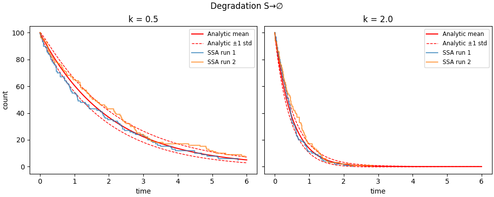
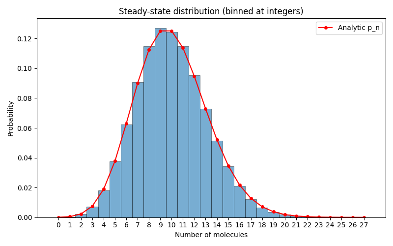
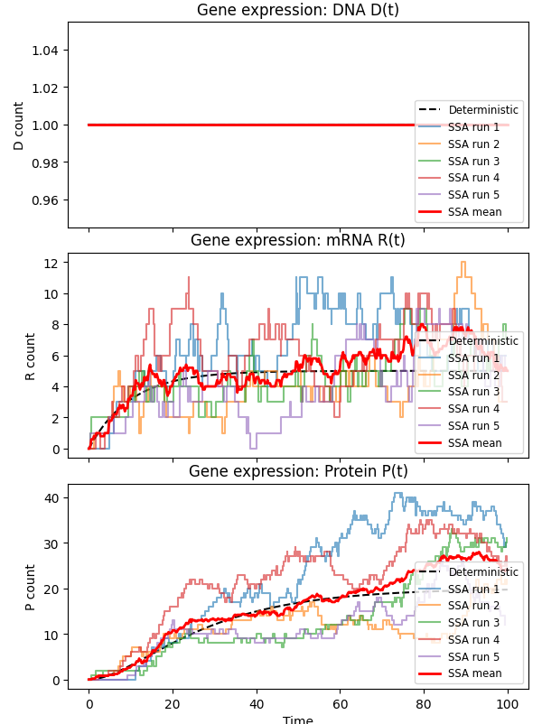
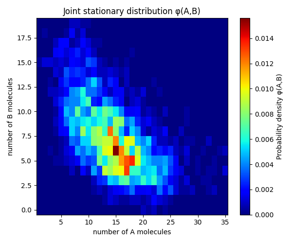

# The Gillespie Algorithm for Stochastic Biochemical Systems

[](LICENSE)

[](report/M2R_Gillespie_Algorithm.pdf)

A Python 3 implementation of **Gillespie's direct-method Stochastic Simulation Algorithm (SSA)**, applied to five classic biochemical reaction networks and benchmarked against analytical solutions and deterministic reaction-rate equations (RREs).

This repository accompanies our second-year group research project (M2R) at the **Department of Mathematics, Imperial College London**, supervised by **Dr Barbara Bravi**.

📄 **Final report:** [`report/M2R_Gillespie_Algorithm.pdf`](report/M2R_Gillespie_Algorithm.pdf)

---

## Contents

- [Overview](#overview)
- [Reaction networks studied](#reaction-networks-studied)
- [Repository structure](#repository-structure)
- [Installation](#installation)
- [Usage](#usage)
- [Script index](#script-index)
- [Selected results](#selected-results)
- [References](#references)
- [How to cite](#how-to-cite)
- [License](#license)

---

## Overview

Inside a single cell, many molecular species are present in copy numbers of only a few tens or fewer, so every reaction is a discrete, random event. The exact description of such a well-mixed system is the **Chemical Master Equation (CME)**:

$$
\frac{\partial P(\mathbf{x}, t \mid \mathbf{x}_0, t_0)}{\partial t}
= \sum_{j=1}^{M} \Big[ a_j(\mathbf{x} - \boldsymbol{\nu}_j)\, P(\mathbf{x} - \boldsymbol{\nu}_j, t \mid \mathbf{x}_0, t_0) - a_j(\mathbf{x})\, P(\mathbf{x}, t \mid \mathbf{x}_0, t_0) \Big],
$$

where $a_j$ is the propensity and $\boldsymbol{\nu}_j$ the state-change vector of reaction $R_j$. The CME has closed-form solutions only for the simplest networks. Gillespie's SSA avoids solving it: it draws **exact sample paths** of the underlying Markov process.

At each step, with total propensity $a_0(\mathbf{x}) = \sum_j a_j(\mathbf{x})$ and two uniform random numbers $r_1, r_2 \sim U(0,1)$:

1. **Time to next reaction:** $\tau = \dfrac{1}{a_0(\mathbf{x})} \ln\dfrac{1}{r_1}$
2. **Which reaction:** the smallest $\mu$ such that $\sum_{j=1}^{\mu} a_j(\mathbf{x}) > r_2\, a_0(\mathbf{x})$
3. **Update:** $t \leftarrow t + \tau$, $\ \mathbf{x} \leftarrow \mathbf{x} + \boldsymbol{\nu}_\mu$

Propensities follow mass-action kinetics, $a_j(\mathbf{x}) = k_j \prod_i \binom{x_i}{\nu^-_{ij}}$. The core implementation is in [`src/gillespie.py`](src/gillespie.py).

## Reaction networks studied

| # | Model | Reactions | Benchmark |
|---|-------|-----------|-----------|
| 1 | **Degradation** | $S \xrightarrow{k} \varnothing$ | Exact binomial solution; mean $X_0 e^{-kt}$ |
| 2 | **Production & degradation** (birth–death) | $\varnothing \xrightarrow{k_2} A,\quad A \xrightarrow{k_1} \varnothing$ | Exact time-dependent PGF solution; Poisson stationary law |
| 3 | **Protein complex formation** | $A + A \xrightarrow{k_1} C,\ \ A + B \xrightarrow{k_2} D,\ \ \varnothing \xrightarrow{k_3} A,\ \ \varnothing \xrightarrow{k_4} B$ | Deterministic RRE; SSA stationary distributions |
| 4 | **Ligand-mediated dimerisation** | $S_1 + S_2 \xrightarrow{k_1} 2S_1,\quad 2S_1 \xrightarrow{k_2} S_1 + S_2$ | Deterministic RRE |
| 5 | **Gene expression** | $D \xrightarrow{k_1} D + R,\ \ R \xrightarrow{k_2} R + P,\ \ R \xrightarrow{k_3} \varnothing,\ \ P \xrightarrow{k_4} \varnothing$ | Analytical means and variances |

Models 1, 2 and 5 have analytical results, which we use to check that the code is correct. Models 3 and 4 contain bimolecular (nonlinear) reactions with no closed-form CME solution. For these we compare SSA ensembles with the deterministic rate equations and look at how noise shifts the stationary behaviour.

## Repository structure

```
.
├── README.md
├── LICENSE                  # MIT License
├── CITATION.cff             # citation metadata (GitHub "Cite this repository")
├── requirements.txt
├── setup.py / pyproject.toml
├── report/
│   └── M2R_Gillespie_Algorithm.pdf   # final project report
├── src/
│   ├── gillespie.py                  # core SSA: Reaction class + my_gillespie()
│   ├── general_use_function.py       # helpers: run SSA / ODE, comparison plot
│   ├── degradation_*.py              # Model 1
│   ├── birth_death_*.py              # Model 2
│   ├── protein_complex_*.py          # Model 3
│   ├── ligand_*.py                   # Model 4
│   └── gene_*.py                     # Model 5
└── figures/                          # figures produced by the scripts
```

## Installation

Requires Python ≥ 3.7.

```bash
git clone https://github.com/YanboHuang23/M2R-Gillespie-algorithm-for-stochastic-biochemical-systems.git
```

```bash
cd M2R-Gillespie-algorithm-for-stochastic-biochemical-systems
```

```bash
pip install -r requirements.txt
```

Dependencies: `numpy`, `scipy`, `matplotlib`.

## Usage

Each script in `src/` is self-contained and imports the shared simulator from `gillespie.py`, so run the scripts from inside `src/`:

```bash
cd src
```

```bash
python birth_death_testing_analytical_solution.py
```

### Defining your own network

A reaction is defined by its reactant and product stoichiometry (`{species_index: count}`) and a rate constant. `my_gillespie` returns the event times and the state trajectory.

```python
from gillespie import Reaction, my_gillespie

k1, k2 = 0.1, 1.0   # degradation and production rates

# species 0 = A
death = Reaction(reactants={0: 1}, products={},      rate=lambda s: k1)  # A -> ∅
birth = Reaction(reactants={},      products={0: 1}, rate=lambda s: k2)  # ∅ -> A

times, traj = my_gillespie([death, birth], initial_state=[0], t_max=100)
# times: shape (n_events + 1,)   traj: shape (n_events + 1, n_species)
```

Propensities are computed by mass action: `rate(state) * Π comb(x_i, ν_i)`. A homodimerisation $A + A \to C$ (`reactants={0: 2}`) therefore gets the combinatorial factor $\binom{x_A}{2}$.

## Script index

<details>
<summary><b>Model 1: Degradation</b></summary>

| Script | Description |
|--------|-------------|
| `degradation_example_in_ref.py` | SSA trajectories vs. analytic mean ± 1 s.d. for two rates (reproduces Gillespie 2007, Fig. 1) |
| `degradation_in_distribution.py` | SSA histogram vs. exact binomial distribution |

</details>

<details>
<summary><b>Model 2: Production & degradation (birth–death)</b></summary>

| Script | Description |
|--------|-------------|
| `birth_death_original.py` | Two SSA runs of ∅ ⇌ A |
| `birth_death_testing_analytical_solution.py` | SSA ensemble vs. analytic mean and variance |
| `birth_death_testing_analytical_solution_for_dis.py` | SSA histogram vs. exact analytic $p_n(t)$ (binomial ⊛ Poisson) |
| `birth_death_integer_distribution.py` | Same comparison, binned at integers |
| `birth_death_heatmap.py` | Steady-state mean over a grid of death/birth rates $(k_1, k_2)$ |

</details>

<details>
<summary><b>Model 3: Protein complex formation</b></summary>

| Script | Description |
|--------|-------------|
| `protein_complex_case{1..4}.py` | SSA vs. RRE trajectories for four initial conditions $(A_0, B_0)$ |
| `protein_complex_case{1..4}_distribution.py` | Marginal stationary distributions of A and B |
| `protein_complex_case1_2D.py` | Joint stationary distribution $\varphi(A, B)$ |

</details>

<details>
<summary><b>Model 4: Ligand-mediated dimerisation</b></summary>

| Script | Description |
|--------|-------------|
| `ligand_dimerization_case{1..4}.py` | SSA vs. RRE trajectories for four parameter sets |
| `ligand_dimerization_case{1..4}_dis.py` | Stationary distributions of $S_1$ and $S_2$ vs. deterministic steady state |
| `ligand_dimerization_case1_s12_2D.py` | Joint distribution of $(S_1, S_2)$ |
| `ligand_heatmap.py` | Steady-state means over a grid of association/dissociation rates $(k_1, k_2)$ |

</details>

<details>
<summary><b>Model 5: Gene expression</b></summary>

| Script | Description |
|--------|-------------|
| `gene_expression_first_example.py` | First example: SSA vs. ODE for mRNA and protein |
| `gene_expression_case1.py` | SSA vs. RRE for DNA, mRNA and protein |
| `gene_expression_vary_k_tx.py` | Effect of the transcription rate $k_{tx}$ |
| `gene_expression_vary_k_tl.py` | Effect of the translation rate $k_{tl}$ |
| `gene_expression_vary_gamma_m.py` | Effect of the mRNA degradation rate $\gamma_m$ |
| `gene_expression_vary_gamma_p.py` | Effect of the protein degradation rate $\gamma_p$ |
| `gene_heatmap.py` | Steady-state mean mRNA / protein over a grid of transcription and translation rates |
| `gene_expression_volume_scaling.py` | Stand-alone SSA showing the effect of system volume |

</details>

## Selected results

| Degradation | Birth–death stationary distribution |
|:---:|:---:|
|  |  |
| **Gene expression** | **Protein complex: joint stationary distribution** |
|  |  |

The full set of figures is in [`figures/`](figures/), and the [report](report/M2R_Gillespie_Algorithm.pdf) discusses each of them.

## References

1. D. T. Gillespie. *Stochastic simulation of chemical kinetics.* **Annual Review of Physical Chemistry**, 58:35–55, 2007. [doi:10.1146/annurev.physchem.58.032806.104637](https://doi.org/10.1146/annurev.physchem.58.032806.104637)
2. D. T. Gillespie. *Markov Processes: An Introduction for Physical Scientists.* Academic Press, 1992.
3. D. T. Gillespie. *Exact stochastic simulation of coupled chemical reactions.* **The Journal of Physical Chemistry**, 81(25):2340–2361, 1977. [doi:10.1021/j100540a008](https://doi.org/10.1021/j100540a008)
4. K. Sasaki. *gillespie-algorithm-python.* GitHub repository. <https://github.com/karinsasaki/gillespie-algorithm-python>
5. R. Erban, S. J. Chapman and P. K. Maini. *A practical guide to stochastic simulations of reaction–diffusion processes.* arXiv:0704.1908, 2007. <https://arxiv.org/abs/0704.1908>
6. J. M. A. Padgett and S. Ilie. *An adaptive tau-leaping method for stochastic simulations of reaction-diffusion systems.* **AIP Advances**, 6(3):035217, 2016. [doi:10.1063/1.4944952](https://doi.org/10.1063/1.4944952)
7. M. A. Gibson and J. Bruck. *Efficient exact stochastic simulation of chemical systems with many species and many channels.* **The Journal of Physical Chemistry A**, 104(9):1876–1889, 2000. [doi:10.1021/jp993732q](https://doi.org/10.1021/jp993732q)
8. Y. Cao, D. T. Gillespie and L. R. Petzold. *The slow-scale stochastic simulation algorithm.* **The Journal of Chemical Physics**, 122(1):014116, 2005. [doi:10.1063/1.1824902](https://doi.org/10.1063/1.1824902)

## How to cite

If you use this code or the report, please cite it. GitHub's **"Cite this repository"** button (generated from [`CITATION.cff`](CITATION.cff)) gives APA and BibTeX. In BibTeX:

```bibtex
@misc{jin2025gillespie,
  title        = {The Gillespie Algorithm for Stochastic Biochemical Systems},
  author       = {Jin, Alex and Huang, Yanbo and Xu, Jiali and Zhu, Yuhan and Yi, Xuancheng},
  year         = {2025},
  howpublished = {Second-year group research project (M2R), Department of Mathematics, Imperial College London},
  note         = {Supervised by Barbara Bravi},
  url          = {https://github.com/YanboHuang23/M2R-Gillespie-algorithm-for-stochastic-biochemical-systems}
}
```

## Authors

Alex Jin · Yanbo Huang · Jiali Xu · Yuhan Zhu · Xuancheng Yi

Supervisor: Dr Barbara Bravi, Department of Mathematics, Imperial College London.

## License

The code is released under the [MIT License](LICENSE). The cited papers belong to their respective authors and publishers and are not included in this repository.
